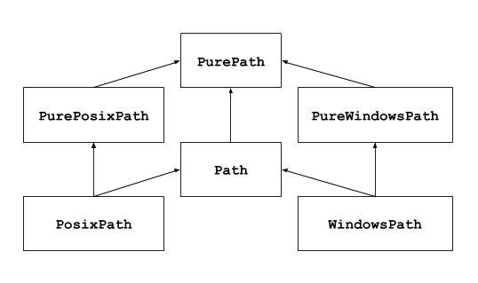

# Librería Path

## Módulo pathlib

Ofrece clases de que represnetan rutas del sistema de archivos con semántica apropiada para diferentes sistemas operativos.

Las clases ruta se dividen entre **rutas puras**, que proporcionan operaciones puramente computacionales sin *E/S*; y **rutas concretas**, que heredan de rutas puras pero también proporcionan operaciones de *E/S*.

- Si previamente no se ha utilizado este módulo o simplemente no se está seguro de qué clase es la adecuada para la tarea que se tiene, **Path** es probablemnete lo que se necesita.